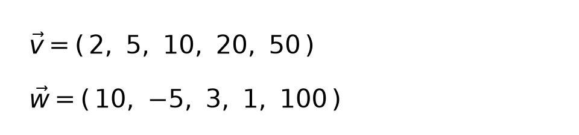
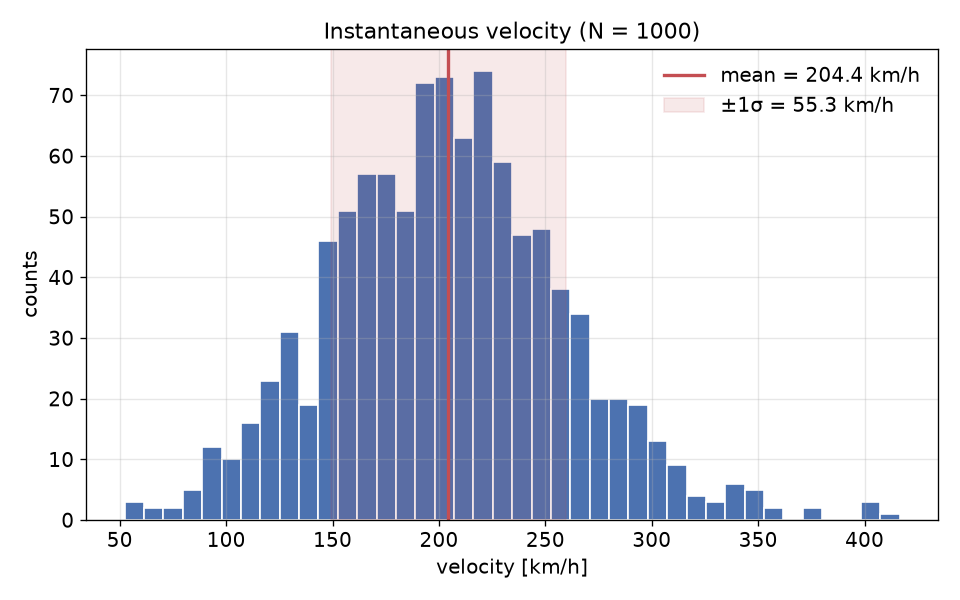
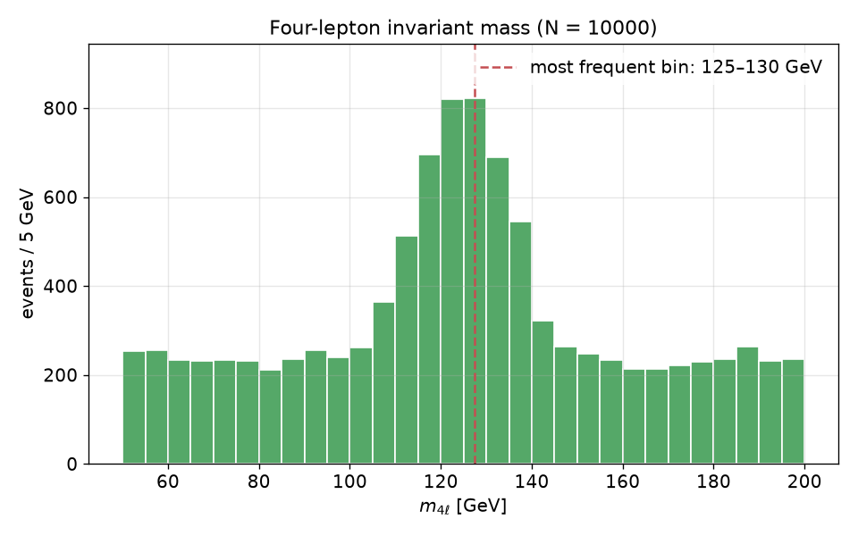

# Computer Science Lab - 6
### Prof. Stefano Carrazza

**Summary:** Basic exercises in C++: arrays.

## Exercise 1 - Hello World arrays

Write a C++ program that uses arrays.

1. Build the following vectors of type double using stack arrays:

    

2. Print to terminal the values of `v` and `w`, following the format:
    ```
      v[0] = <value>
      v[1] = <value>
      ...
      w[0] = <value>
      w[1] = <value>
      ...
    ```

3. Create an array `double s[5]` and initialize `s` with the values of `v`.

4. Add the values of `w` to `s`.

5. Print `s` to the screen, following the format in point 2.

## Exercise 2 - Dot product

Write a C++ program that calculates the dot product between dynamic arrays.

1. Build the vectors `v` and `w` above using dynamic arrays. Remember to allocate dynamic arrays with the `new` operator and delete them at the end of the program/scope with the `delete` operator.

2. Implement the dot product between `v` and `w` and print the result.

3. Create a vector `z` equal to `v` (same size and copy of contents) with `z[2] = 0`.

4. Calculate the normalization of `z`.

5. Normalize `z` and print its values to the terminal.

## Exercise 3 - Matrix product
Write a C++ program that calculates the product between matrices.

## Exercise 4 - Linear motion

Write a C++ program that reads from file the space and time of a charged particle in linear motion, calculates the instantaneous velocity for each measurement and determines the average velocity, its standard deviation, its minimum and maximum value.

1. Read from file the `N=1000` (known number of elements) copies of points **(x y)** with the variations of space (km) and time (h), calculating for each element the instantaneous velocity. Save these values in an array of type `double`.

2. Calculate the average velocity, the respective standard deviation and print the results to the screen.

3. Calculate the minimum and maximum velocity and print the results to the screen.

4. Verify the results with the following plot:



## Exercise 5 - Find the Higgs boson mass

Write a C++ program that reads from file the measurements of the invariant mass distribution for the Higgs boson production channel from 4 leptons, performed by a particle accelerator, and determines the most frequent value for its mass.

The distribution is graphically shown as follows:



1. Read all `N = 10000` invariant mass values and save the data in an array `mass`.

2. Sort the `mass` vector in ascending order using selection sort. (Check the algorithm by printing all values to the screen)

3. Extract the minimum and maximum value directly from `mass` (without implementing loops or algorithms). Print the values to the terminal.

4. Build an array `bins` containing the upper edges of a histogram starting from the minimum mass value to the maximum value with steps of 5 GeV. Tip: determine the number of bins needed and create a dynamic array for binning.

5. Create an array `freq` for the histogram frequencies.

6. Histogram and print to the screen the values of bins and frequencies.

7. Determine the bin (lower-edge) of Higgs mass with the highest frequency.
